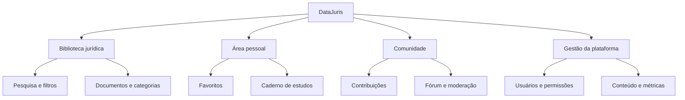

<!-- DataJuris | README principal -->
<div align="center">
  

  <br />

  <p>
    <strong>Pesquisa, organização e produtividade para a rotina jurídica.</strong><br />
    Uma plataforma independente em evolução para estudantes, profissionais e entusiastas do Direito.
  </p>

  <p>
    <a href="https://freitasdeveloper.github.io/DataJuris/"></a>
    <a href="https://github.com/freitasdeveloper/DataJuris"></a>
  </p>

  <p>
    
    
    
    
    
    
  </p>
</div>

---

## ✨ Sobre o DataJuris

O **DataJuris** está sendo desenvolvido para reunir, em uma experiência simples e organizada, ferramentas que apoiem o estudo e o trabalho jurídico.

A proposta é facilitar a descoberta de referências, a organização de materiais e a construção de conhecimento — com uma interface responsiva e uma base técnica preparada para evoluir.

> ⚖️ **Conhecimento jurídico organizado. Rotina mais inteligente.**

## 🚀 A plataforma

| 📚 Biblioteca jurídica | 📝 Caderno de estudos |
|:--|:--|
| Explore documentos demonstrativos, pesquise por palavras-chave e filtre por área do Direito. | Registre resumos e ideias, organize por área, pesquise, edite e exclua anotações. |

| ❤️ Favoritos | 🔐 Conta e acesso |
|:--|:--|
| Salve documentos de interesse neste navegador. | Interface de login/cadastro preparada; autenticação real depende de configuração e testes do Supabase. |

### Funcionalidades e estágio atual

| Recurso | Situação | Observações |
|:--|:--:|:--|
| Interface responsiva e navegação | 🟢 Disponível | Front-end publicado no GitHub Pages |
| Pesquisa e filtros da biblioteca | 🟢 Disponível | Conteúdo demonstrativo local |
| Favoritos | 🟢 Disponível | Armazenados neste navegador |
| Meu Caderno | 🟢 Disponível | Anotações locais; sem sincronização entre dispositivos |
| Banco de dados Supabase | 🟡 Implantado | 16 tabelas com RLS; histórico de migrações e testes de usuários ainda pendentes |
| Segurança de conteúdo | 🟡 Base implantada | Funções privadas, triggers e índices; revisão funcional contínua |
| Storage privado | 🟡 Configurado | Bucket e políticas implantados; upload/download da interface ainda não validado |
| Autenticação real | 🟡 Pendente | Exige SMTP, redirects e testes com contas distintas |
| Fórum e contribuições | ⚪ Em integração | Estrutura de banco criada; fluxos da interface ainda não validados |
| Painel administrativo | ⚪ Planejado | Requer fluxos de gestão e autorização ponta a ponta |

<sub>Legenda: 🟢 disponível no protótipo · 🟡 infraestrutura preparada/implantada, validação pendente · ⚪ planejado ou não integrado.</sub>

## 🧭 Visão do produto

O DataJuris está sendo construído em etapas, priorizando uma base confiável antes de habilitar operações que envolvam contas, arquivos e dados de usuários.



## 🛠️ Tecnologias

<div align="center">
  
</div>

- **React 19** — construção da interface.
- **TypeScript** — tipagem e manutenção do código.
- **Vite** — desenvolvimento e compilação.
- **CSS** — identidade visual e responsividade.
- **Supabase** — autenticação, PostgreSQL com RLS e Storage privado.
- **GitHub Actions + GitHub Pages** — compilação, testes automatizados e publicação.

## 💻 Executar localmente (opcional)

O projeto pode ser trabalhado diretamente pelo GitHub. Não é necessário manter uma cópia local para consultar o código ou acompanhar as Actions.

### Pré-requisitos

- Node.js 22 ou superior
- npm

### Instalação

```bash
git clone https://github.com/freitasdeveloper/DataJuris.git
cd DataJuris
npm install
npm run dev
```

Para gerar a versão de produção:

```bash
npm run build
npm run preview
```

## 🔑 Supabase e segurança

O projeto utiliza o Supabase `tlpbmatbkdphpvnkprxn` (`https://tlpbmatbkdphpvnkprxn.supabase.co`). A estrutura inicial já foi implantada: seis migrações versionadas, 16 tabelas públicas protegidas por RLS, bucket privado, políticas de Storage, índices e triggers de integridade.

**Atenção ao histórico:** o conector registrou operações com timestamps diferentes dos seis arquivos versionados. O workflow manual **Repair Supabase Migration History** foi adicionado para reconciliar apenas o histórico, sem reaplicar SQL. Antes de executá-lo, configure os secrets `SUPABASE_ACCESS_TOKEN` e `SUPABASE_DB_PASSWORD` nas configurações do repositório e siga o [guia de validação](docs/SUPABASE_VALIDATION.md).

O workflow **DataJuris Database Tests** reconstrói um banco Supabase limpo no GitHub Actions e executa testes pgTAP a cada push/PR em `main`.

**Nunca coloque chaves secretas ou `service_role` no código do navegador, no repositório ou em variáveis com prefixo `VITE_`.** A chave pública/publishable não substitui as políticas de segurança do banco.

Mais detalhes: [guia de implantação](docs/DEPLOYMENT.md) · [validação Supabase](docs/SUPABASE_VALIDATION.md) · [revisão inicial de segurança](docs/SECURITY_REVIEW.md).

## 🗺️ Roadmap

- [x] Identidade visual e interface inicial.
- [x] Biblioteca demonstrativa com pesquisa e filtros.
- [x] Favoritos locais.
- [x] Caderno de estudos local.
- [x] Estrutura inicial de banco de dados e políticas RLS.
- [x] Storage privado, índices e triggers de integridade.
- [x] Testes automatizados de base de dados adicionados ao GitHub Actions.
- [ ] Reconciliar histórico remoto das migrações.
- [ ] Configurar e validar autenticação real com contas de teste.
- [ ] Persistir documentos, favoritos e anotações por usuário.
- [ ] Integrar upload e download seguro de arquivos à interface.
- [ ] Concluir painel administrativo, contribuições, fórum e moderação.
- [ ] Testes completos de fluxos, segurança, acessibilidade e carga.

Consulte o [roadmap detalhado](docs/ROADMAP.md) e o [status de implementação](docs/IMPLEMENTATION_STATUS.md).

## 🔒 Privacidade e uso responsável

- O caderno e os favoritos atuais usam armazenamento local do navegador; não há sincronização entre dispositivos.
- Limpar os dados do navegador pode remover esses registros locais.
- Não insira informações pessoais, sigilosas ou dados de clientes e processos no protótipo.
- Os materiais exibidos atualmente são demonstrativos e não devem ser tratados como modelos jurídicos revisados ou aconselhamento profissional.
- O projeto ainda está em desenvolvimento e **não está liberado como SaaS comercial**.

## 🤝 Contribuição

Sugestões, relatos de problemas e melhorias são bem-vindos. Abra uma [Issue](https://github.com/freitasdeveloper/DataJuris/issues) descrevendo o contexto, o comportamento observado e, se possível, os passos para reproduzir.

## 📄 Documentação

- [Roadmap do produto](docs/ROADMAP.md)
- [Status da implementação](docs/IMPLEMENTATION_STATUS.md)
- [Guia de implantação](docs/DEPLOYMENT.md)
- [Validação do Supabase e testes](docs/SUPABASE_VALIDATION.md)
- [Revisão inicial de segurança](docs/SECURITY_REVIEW.md)

---

<div align="center">
  <strong>DATAJURIS</strong><br />
  <sub>Conhecimento jurídico em movimento.</sub><br /><br />
  <a href="https://freitasdeveloper.github.io/DataJuris/">Acessar demonstração</a>
</div>
