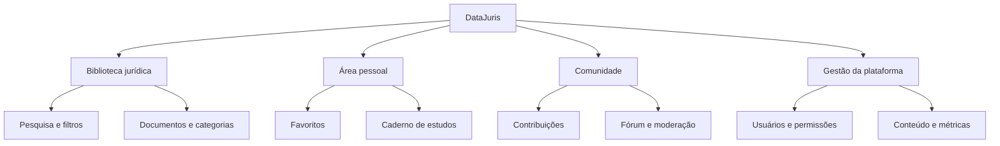

<!-- DataJuris | README principal -->
<div align="center">
  

  <br />

  <p>
    <strong>Pesquisa, organização e produtividade para a rotina jurídica.</strong><br />
    Uma plataforma independente em evolução para estudantes, profissionais e entusiastas do Direito.
  </p>

  <p>
    <a href="https://freitasdeveloper.github.io/DataJuris/"></a>
    <a href="https://github.com/freitasdeveloper/DataJuris"></a>
  </p>

  <p>
    
    
    
    
    
    
  </p>
</div>

---

## ✨ Sobre o DataJuris

O **DataJuris** está sendo desenvolvido para reunir, em uma experiência simples e organizada, ferramentas que apoiem o estudo e o trabalho jurídico.

A proposta é facilitar a descoberta de referências, a organização de materiais e a construção de conhecimento — com uma interface responsiva e uma base técnica preparada para evoluir.

> ⚖️ **Conhecimento jurídico organizado. Rotina mais inteligente.**

## 🚀 A plataforma

| 📚 Biblioteca jurídica | 📝 Caderno de estudos |
|:--|:--|
| Explore documentos demonstrativos, pesquise por palavras-chave e filtre por área do Direito. | Registre resumos e ideias, organize por área, pesquise, edite e exclua anotações. |

| ❤️ Favoritos | 🔐 Conta e acesso |
|:--|:--|
| Salve documentos de interesse neste navegador. | Interface de login e cadastro preparada para integração com Supabase. A autenticação depende da configuração do serviço. |

### Funcionalidades e estágio atual

| Recurso | Situação | Observações |
|:--|:--:|:--|
| Interface responsiva e navegação | 🟢 Disponível | Front-end publicado no GitHub Pages |
| Pesquisa e filtros da biblioteca | 🟢 Disponível | Trabalham com conteúdo demonstrativo local |
| Favoritos | 🟢 Disponível | Armazenados neste navegador |
| Meu Caderno | 🟢 Disponível | Criar, editar, excluir e pesquisar anotações locais |
| Modal de login e cadastro | 🟡 Preparado | Requer URL e chave pública do projeto Supabase |
| Banco de dados e políticas de acesso | 🟡 Estrutura inicial | Migração SQL disponível; requer implantação e testes |
| Upload e biblioteca real de arquivos | ⚪ Planejado | Ainda não conectado ao armazenamento |
| Fórum, comunidade e moderação | ⚪ Planejado | Próximas etapas de desenvolvimento |
| Painel administrativo | ⚪ Planejado | Requer backend e perfis de acesso |

<sub>Legenda: 🟢 disponível no protótipo · 🟡 preparado, depende de configuração/validação · ⚪ planejado.</sub>

## 🧭 Visão do produto

O DataJuris está sendo construído em etapas, priorizando uma base confiável antes de habilitar operações que envolvam contas, arquivos e dados de usuários.



## 🛠️ Tecnologias

<div align="center">
  
</div>

- **React 19** — construção da interface.
- **TypeScript** — tipagem e manutenção do código.
- **Vite** — desenvolvimento e compilação.
- **CSS** — identidade visual e responsividade.
- **Supabase** — integração planejada para autenticação, banco de dados e armazenamento.
- **GitHub Actions + GitHub Pages** — validação automatizada e publicação do front-end.

## 💻 Executar localmente

### Pré-requisitos

- Node.js 22 ou superior
- npm

### Instalação

```bash
git clone https://github.com/freitasdeveloper/DataJuris.git
cd DataJuris
npm install
npm run dev
```

Para gerar a versão de produção:

```bash
npm run build
npm run preview
```

## 🔑 Configuração do Supabase

A integração está preparada para o projeto `tlpbmatbkdphpvnkprxn` (`https://tlpbmatbkdphpvnkprxn.supabase.co`); configure a publishable key correspondente a esse projeto. Para habilitar a autenticação e os recursos conectados:

1. Crie um projeto no [Supabase](https://supabase.com/).
2. Copie o arquivo de exemplo `.env.example` para `.env.local`.
3. Preencha `VITE_SUPABASE_URL` e `VITE_SUPABASE_PUBLISHABLE_KEY` com os dados do mesmo projeto Supabase.
4. Aplique a migração SQL disponível em `supabase/migrations/` no projeto correto.
5. Revise e teste as políticas de segurança e o armazenamento antes de disponibilizar dados reais.

**Atenção:** nunca coloque chaves secretas ou `service_role` no código do navegador, no repositório ou em variáveis com prefixo `VITE_`. A chave pública/anon não substitui as políticas de segurança do banco.

Mais detalhes: [guia de implantação](docs/DEPLOYMENT.md) · [validação Supabase](docs/SUPABASE_VALIDATION.md) · [revisão inicial de segurança](docs/SECURITY_REVIEW.md).

## 🗺️ Roadmap

- [x] Identidade visual e interface inicial.
- [x] Biblioteca demonstrativa com pesquisa e filtros.
- [x] Favoritos locais.
- [x] Caderno de estudos local.
- [x] Estrutura inicial de banco de dados e políticas RLS.
- [x] Base de autenticação e modal de acesso.
- [ ] Configurar e validar projeto Supabase real.
- [ ] Persistir documentos, favoritos e anotações por usuário.
- [ ] Upload e download seguro de arquivos.
- [ ] Painel administrativo e gestão de permissões.
- [ ] Contribuições, fórum e moderação.
- [ ] Testes automatizados de fluxos, segurança e acessibilidade.

Consulte o [roadmap detalhado](docs/ROADMAP.md) e o [status de implementação](docs/IMPLEMENTATION_STATUS.md).

## 🔒 Privacidade e uso responsável

- O caderno e os favoritos atuais usam armazenamento local do navegador; não há sincronização entre dispositivos.
- Limpar os dados do navegador pode remover esses registros locais.
- Não insira informações pessoais, sigilosas ou dados de clientes e processos no protótipo.
- Os materiais exibidos atualmente são demonstrativos e não devem ser tratados como modelos jurídicos revisados ou aconselhamento profissional.
- O projeto ainda está em desenvolvimento e **não está liberado como SaaS comercial**.

## 🤝 Contribuição

Sugestões, relatos de problemas e melhorias são bem-vindos. Abra uma [Issue](https://github.com/freitasdeveloper/DataJuris/issues) descrevendo o contexto, o comportamento observado e, se possível, os passos para reproduzir.

## 📄 Documentação

- [Roadmap do produto](docs/ROADMAP.md)
- [Status da implementação](docs/IMPLEMENTATION_STATUS.md)
- [Guia de implantação](docs/DEPLOYMENT.md)
- [Revisão inicial de segurança](docs/SECURITY_REVIEW.md)

---

<div align="center">
  <strong>DATAJURIS</strong><br />
  <sub>Conhecimento jurídico em movimento.</sub><br /><br />
  <a href="https://freitasdeveloper.github.io/DataJuris/">🌐 Abrir demonstração</a>
  &nbsp;·&nbsp;
  <a href="https://github.com/freitasdeveloper/DataJuris/issues">💡 Sugerir melhoria</a>
  &nbsp;·&nbsp;
  <a href="https://github.com/freitasdeveloper/DataJuris">⭐ Ver repositório</a>
</div>
